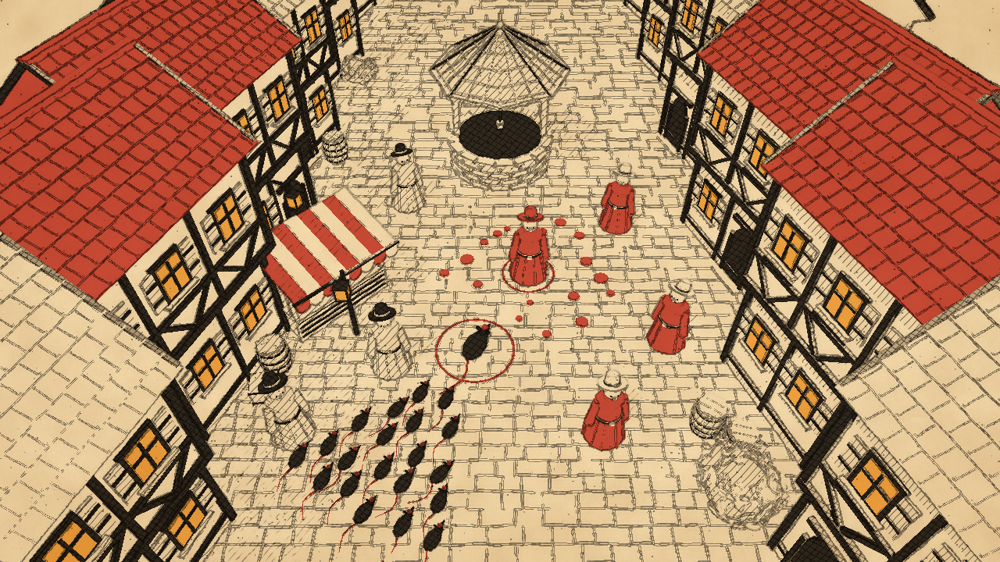

# Plaag — parchment & ink rendering

A Godot 4.6 (Forward+) project that renders ordinary 3D models as an old
manuscript illustration: sepia ink outlines with hand-drawn wobble, flat tone
bands filled with hatching instead of smooth lighting, parchment paper with
grain and stains, and a small palette of ink accents (red, amber, blue).



Reference material lives in `docs/`: the plague square illustration is the
main target, the Potion Craft screenshot and the house / castle sheets set the
pen-and-wash texture.

Everything is done in one full-screen post-process shader,
[shaders/parchment_ink.gdshader](shaders/parchment_ink.gdshader), so any model
gets the style for free. The demo scene builds a town square out of primitive
meshes ([scripts/demo_town.gd](scripts/demo_town.gd) lays it out, the props
come from [scripts/town_props.gd](scripts/town_props.gd)); swap in real models later.

## The game prototype

Plaag is a plague incremental: you are a rat Colony spreading the Black Death
through a medieval city in short Rounds, with an Upgrade Tree between them.
Design: [docs/game_concept.md](docs/game_concept.md) · terms:
[GLOSSARY.md](GLOSSARY.md) · build plan and per-milestone contracts:
[docs/prototype_build_plan.md](docs/prototype_build_plan.md), `docs/dev/`.

Press Play: the main scene is the District ([scenes/game/district.tscn](scenes/game/district.tscn)).
The loop is **Round → Upgrade Tree → Scroll Map → Round**.

| Action | Keyboard + mouse | Gamepad |
| --- | --- | --- |
| Move the Lead Rat | WASD / arrows | Left stick |
| Bite | automatic | automatic |
| Hide (once unlocked) | walk into a house door | walk into a door |
| Raid (once unlocked) | click a house | A (nearest house) |
| Continue / buy / begin | click, Enter | A |

Useful flags (after `--`): `--fresh` wipes the save, `--dev` unlocks Hide,
Raid, Fleas and Contagion and enables R to restart, `--year=<n>` plays a Year
without saving it, `--district=merchant`, `--stage=<0..2>`,
`--start-colony=<n>`, `--god`, `--bot` (the Lead Rat plays itself),
`--force-exterminator`, `--perf`, `--screenshot=<png>`. The full list is in
the header of [scripts/game/district.gd](scripts/game/district.gd).

## Running the style demo

The original style test is [scenes/main.tscn](scenes/main.tscn). Open it in
the editor and press F6, or from a shell:

```bash
"C:/Users/Home/Downloads/Godot_v4.6.3-stable_win64/Godot_v4.6.3-stable_win64_console.exe" --path . res://scenes/main.tscn
```

Press **Tab** in the running scene to toggle the effect and compare with the raw render.

Debug flags (after a `--` separator) let you override any float uniform and
save a screenshot without touching the scene:

```bash
"C:/Users/Home/Downloads/Godot_v4.6.3-stable_win64/Godot_v4.6.3-stable_win64_console.exe" --path . res://scenes/main.tscn --resolution 1280x720 -- --set=hatch_spacing=10 --set=wobble_amount=3 --screenshot=C:/temp/shot.png
```

`--no-shadows` disables the sun's shadows, `--set=effect_mix=0` shows the plain render.

## Using it in your own scene

1. Make sure the project uses the **Forward+** renderer (the shader reads the
   normal-roughness buffer, which Mobile and Compatibility do not provide).
2. Add a `MeshInstance3D` as a child of your `Camera3D`:
   * mesh: `QuadMesh`, size `(2, 2)`, `flip_faces = true`
   * `extra_cull_margin = 16384` so it is never frustum-culled
   * `material_override`: a `ShaderMaterial` using `parchment_ink.gdshader`
   * script: [scripts/parchment_overlay.gd](scripts/parchment_overlay.gd), with
     its `sun` export pointed at your `DirectionalLight3D` (it passes the light
     direction to the shader for the normal-based tone bands and handles Tab).
3. In the `WorldEnvironment` set the tonemapper to **Linear** so the palette
   colours come out exactly as picked. Background colour is irrelevant: the
   shader paints sky pixels as blank paper.

See [scenes/main.tscn](scenes/main.tscn) for a working setup.

### How to colour your models

The shader decides what a pixel becomes from the rendered colour, so the
materials are the only "style sheet" the artists need to follow:

| Albedo you give a model                      | What the shader draws                       |
|----------------------------------------------|---------------------------------------------|
| Pale, low-saturation (cream, grey, dull wood)| Parchment, with hatching where it is dark   |
| Saturated red                                | Red ink wash (hatching still applies)       |
| Saturated orange / yellow                    | Amber wash; if emissive it glows, un-hatched|
| Saturated green                              | Sage-green wash (bushes, grass, cloaks)     |
| Saturated blue                               | Blue ink wash                               |
| Near-black                                   | Solid ink (rats, ravens, iron)              |

Saturation is measured in gamma space, like the colour picker shows it; the
cut-off is `accent_saturation_threshold` (0.45). Purple and cyan have no ink
and are drawn as plain parchment. The washes themselves are fixed palette
colours, so a bright crimson and a dull brick red both come out as the same
dusty red: the model's colour only picks the ink, the palette uniforms decide
how it looks.

Textures work too: the style is applied to the final lit colour. Keep textures
fairly flat; fine detail turns into noise under the hatching.

### Tuning

All knobs are shader uniforms, grouped in the inspector:

* **Palette** — the two parchment tones, ink colour, four accent inks, accent
  opacity (how much paper shows through a wash).
* **Ink lines** — `silhouette_width` for object outlines and `line_width` for
  creases inside a surface (both in pixels), depth/normal edge sensitivity,
  `line_halo` / `line_halo_radius` for the grainy ink bleed beside lines,
  `wobble_amount` / `wobble_scale` for the hand-drawn jitter, `line_boil_speed`
  (> 0 makes lines shimmer like hand-drawn animation).
* **Shading** — the three brightness thresholds (paper / single hatch / cross
  hatch / solid ink), `shade_from_normals` (0 = use rendered lighting incl.
  shadows, 1 = pure surface-normal shading), hatch spacing, width, angle and
  strength, `stipple_strength` for pen dots in the shaded bands, and
  `tone_strength` for the flat darkening of hatched areas.
* **Paper** — `paper_grain` (tone variation), `surface_grain` (fine noise over
  everything, ink included), `paper_mottle` / `paper_mottle_scale` for the
  plaster-like cell pattern, stains, `ink_speckle` for stray flecks, vignette,
  and `effect_mix` to fade the whole effect.

Line width and hatch spacing are in screen pixels, so they stay the same size
on screen regardless of zoom. If you render at a different resolution scale,
adjust them.

## Known limitations / ideas

* Forward+ only (needs the normal-roughness texture). A port to Mobile would
  have to drop normal edges and derive them from depth instead.
* MSAA is disabled in project settings because the normal-roughness buffer is
  not multisampled; the wobble and paper grain hide the aliasing well.
* Surface detail must be real geometry: the demo's cobbles are a MultiMesh of
  low bevelled slabs (`town_props.gd`, `cobbles()`); the bevel slope sets how
  dark their joints are inked, and stones grow with distance so the far
  pavement does not turn into a mesh of pixel-wide lines.
* Shingles, timber framing and other "drawn" details come from geometry.
  Thin raised strips on a roof become hatched lines, exactly like the
  reference illustration.
* Decorative page borders / illuminated capitals are best done as a 2D
  `CanvasLayer` on top.
